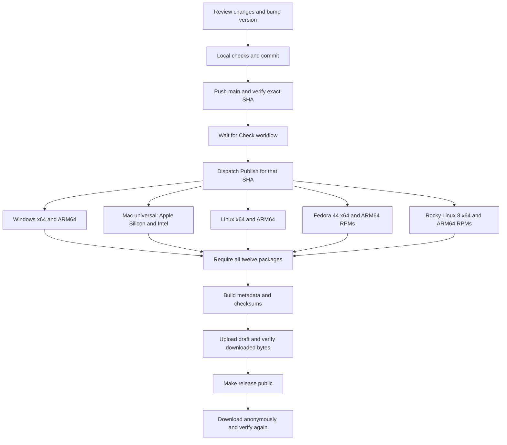

# Publish Cult Copy

The owner can ask an agent:

> Great, push this to Git and build all binaries for public download. Follow publish.md.

This procedure commits the intended changes, synchronizes `main`, waits for its
checks, dispatches native Windows/macOS/Linux builds, and publishes verified
installers on GitHub Releases. The cloud build job is the "render job" in this
process; a local Windows machine does not need a Mac toolchain.

Repository: <https://github.com/bryancolvinfilm-bot/cult-copy>

Public downloads: <https://github.com/bryancolvinfilm-bot/cult-copy/releases/latest>

Cult Copy is the project, package, executable, and display name. Preserve upgrade
migration for existing installations. Installer/download filenames
use `CultCopy-`; old release assets retain their published names. Mac upgrades
from the original app name use the PKG's bundle migration. The DMG is suitable
for new installs and subsequent Cult Copy upgrades.

## Agent procedure

1. Read `git status`, the current branch, recent commits, and `origin`. Review
   the actual changes. Preserve unrelated work. Stage only the source and
   documentation intended for this release; never include local clipboard
   profiles, `.tools`, `target`, `dist`, credentials, or logs.
2. Use `main`. Fetch `origin/main` and tags. Fast-forward when behind; resolve
   divergence normally. Do not force-push or move an existing version tag.
3. Read `[package].version` in `Cargo.toml`. If this version has already been
   tagged for a different commit, choose the next patch version unless the user
   specified another version. Update `Cargo.toml`, run Cargo once without
   `--locked` to update the package's lockfile entry, and review the lockfile
   diff. Packaging derives filenames, installer versions, and Mac bundle
   versions from `Cargo.toml`; do not edit version strings in each packager.
   Review `packaging/release-targets.json` for every required platform, including
   Fedora 44 and Rocky Linux 8 RPMs on both x64 and ARM64. Build each RPM inside
   its matching distro container; an Ubuntu executable renamed as an RPM does
   not establish Rocky 8 compatibility.
4. Run appropriate local checks. For Rust changes, use `cargo fmt --all --
   --check`, `cargo clippy --locked --all-targets --all-features -- -D warnings`,
   and `cargo test --locked --all-targets`. The project-local Windows toolchain
   can be invoked through `scripts/dev.ps1`. Native clipboard tests overwrite
   the clipboard: leave them to the disposable CI desktops.
5. Stage the reviewed files and create a meaningful commit. Confirm the working
   tree is clean. If there are no changes, reuse the current commit.
6. Run the publisher from the repository root:

   ```powershell
   .\scripts\publish.ps1
   ```

   With PowerShell 7 on macOS/Linux, use `pwsh ./scripts/publish.ps1`.
   It requires Git, normal Git push authentication, and an existing GitHub
   sign-in through `GH_TOKEN`, `GITHUB_TOKEN`, GitHub CLI, or Git Credential
   Manager. No token is printed, saved in the repository, or added to a remote.
   On a sandboxed Windows agent, Git and Credential Manager may need to run as
   the normal Windows user through the tool's standard approval mechanism.
7. Keep following the publisher until it finishes. It fetches and fast-forwards
   if necessary, pushes `main`, checks that the remote SHA matches, and waits
   for **Check** on that exact SHA. It then dispatches **Publish** for the same
   SHA, follows every platform job, and verifies the resulting public downloads.
   Do not treat a successful push or a queued build as completion.
8. Report the source commit, release URL, and the platform download table.
   State any genuine build or download failure instead of reporting success.
   Release signing/notarization is not configured; do not describe the builds
   as signed public production releases.

Publishing requires a user request that includes making a release/downloads.
A request only to commit or push code should stop after those actions. Once a
public release is requested, do the checks, native builds, uploads, and public
download verification without asking for the same authorization again.

## What GitHub Actions does

The workflow is `.github/workflows/build.yml`, displayed as **Test, build, and
publish**. Pushes to `main` and pull requests run checks and build artifacts;
they do not publish a release. A manual dispatch selects `main`, supplies its
full `expected_sha`, and sets `publish_release=true` to publish.

The metadata job verifies the requested commit, reads the version, and derives
separate desktop and RPM matrices from the release-target manifest. Five desktop
jobs and four distro-container jobs run formatting, all-feature Clippy,
unit/integration tests, and native clipboard round trips. They build:

| Platform | Public assets (after `CultCopy-<version>-`) |
| --- | --- |
| Windows x64 | `windows-x64-setup.exe` |
| Windows ARM64 | `windows-arm64-setup.exe` |
| macOS, Apple Silicon + Intel | `macos-universal.dmg`, `macos-universal.pkg` |
| Linux x64 | `linux-x64.AppImage`, `linux-x64.run` |
| Linux ARM64 | `linux-arm64.AppImage`, `linux-arm64.run` |
| Fedora 44 x64 | `fedora-x64.rpm` |
| Fedora 44 ARM64 | `fedora-arm64.rpm` |
| Rocky Linux 8 x64 | `rocky8-x64.rpm` |
| Rocky Linux 8 ARM64 | `rocky8-arm64.rpm` |

`packaging/release-targets.json` is the shared source for the runner matrix and
required release filenames. Both publisher/verifier scripts read it; adding a
platform requires its packages to pass the same complete-release checks.

Mac packaging verifies both architectures, the ad-hoc code signature, and that
iconutil can decode the embedded ICNS. Linux
packaging installs into a disposable directory and runs both the installed
binary and the AppImage without FUSE. Windows EXE/setup files embed the ICO.
Native Linux clipboard testing uses Xvfb/X11; this does not certify every Wayland
compositor. Windows packaging uses the native MSVC runtime configuration.

Fedora jobs use `quay.io/fedora/fedora:44`; Rocky jobs use
`docker.io/library/rockylinux:8` and enable PowerTools for development headers.
Both architectures build natively on matching GitHub-hosted runners, without
CPU emulation. RPMs include runtime library dependencies, the desktop entry,
PNG/SVG icons, and license notices. Each job installs its RPM with DNF, runs the
installed executable, verifies architecture and package files, validates the
launcher and icons, renders a diagnostic app window on a private Xvfb display,
and exercises close/reopen, background startup, instance activation, hidden
updates, the version label, and tray Quit before uninstalling it. Ubuntu and
Fedora jobs check both X11 and headless Wayland. Rocky 8 checks X11; its build
repositories do not provide Weston. The GUI check catches dynamically loaded
libraries such as `libxkbcommon-x11` that compilation and `--version` cannot
validate. Any failure blocks publication.

To reproduce a distro build locally on the host architecture:

```sh
bash scripts/build-linux-distro.sh fedora
bash scripts/build-linux-distro.sh rocky8
# Optional second argument selects podman or docker.
```

These commands run tests, including clipboard writes, inside disposable
containers and put RPMs in `dist/`. `scripts/package-rpm.sh` is the native
packager for an already provisioned matching distro. Keep the distro versions,
container tags, dependency setup, README, release notes, and this procedure
aligned when changing the supported Fedora/Rocky baselines. Never raise the
Rocky 8 glibc baseline by building its executable on Ubuntu or Fedora.

Only if every platform passes does the publish job run. It downloads artifacts
from that same workflow/SHA and requires all twelve packages. It creates
`BUILD-INFO.json` with the source commit, version, workflow URL, sizes, and
SHA-256 hashes, plus `CHECKSUMS.sha256` covering the installers and build info.

It checks `main` has not changed, creates immutable tag `v<version>` pointing
to the tested commit, and uploads the fourteen assets to a **draft** release. It
downloads the uploaded assets and checks their hashes before making the release
public and marking it latest. A failure leaves no partially published release.
The release notes describe Cult Copy and explain that the Windows/package
builds are unsigned and the Mac app is ad-hoc signed rather than notarized.

The local publisher then downloads those fourteen files anonymously and verifies
them again. Its copies remain in an ignored `.tools/public-download-*` directory.
GitHub Actions artifacts are temporary build products; GitHub Release assets are
the public downloads to share with users.

## If something fails

- Check the exact workflow URL printed by the publisher. Read the failed job's
  logs, fix the cause, commit, and push. Keep meaningful native tests enabled.
- If `main` changes during a release, synchronize and publish the new commit.
  All reported assets must correspond to the same source SHA.
- Published releases and existing tags are not overwritten. A new commit needs
  a new version if the old version was already tagged. A failed upload can
  resume an existing **draft** only when its tag still points at the same SHA.
- Running the publisher again for the exact already-published commit verifies
  its downloads and returns its links instead of replacing the release.
- If authentication is missing or lacks repository/Actions permissions, use
  the normal GitHub login/permission flow. Never ask someone to paste a token
  into a public issue, chat transcript, source file, or command-line argument.
- A timeout does not cancel the cloud jobs. Inspect Actions before dispatching
  again. The publisher resumes an active matching publish run when possible.

For a GitHub CLI fallback, first push and wait for the successful **Check** run
for the exact commit. Then dispatch:

```sh
gh workflow run build.yml --ref main -f expected_sha=FULL_COMMIT_SHA -F publish_release=true
gh run list --workflow build.yml --branch main
gh run watch RUN_ID --exit-status
gh release view vVERSION
```

Verify all fourteen public assets with `scripts/release-assets.ps1 -Mode Verify`
and the expected version/source SHA. Do not select an unrelated successful run.

References: [manual workflow dispatch](https://cli.github.com/manual/gh_workflow_run),
[release creation](https://cli.github.com/manual/gh_release_create),
[artifact handling](https://github.com/actions/upload-artifact).

## Release flow



AppImages use Ubuntu 24.04's glibc baseline and the user's system graphics and
desktop libraries; they do not promise compatibility with every Linux distro.
The `.run` alternatives install per-user desktop entries. macOS `.dmg` lets the
user drag the app into Applications; `.pkg` remains available. Both contain the
same universal app and embedded icon. Public filename architecture labels are
consistently `x64`, `arm64`, or `universal`.

Fedora 44 and Rocky Linux 8 users should choose the matching distro RPM. Rocky
8 RPMs are compiled against glibc 2.28; Fedora builds are not substitutes for
Rocky builds. DNF resolves system desktop/graphics dependencies. Installing on
a headless server does not provide a desktop or clipboard session. GNOME's tray
extension and Wayland clipboard limitations still apply; container checks do
not certify all GNOME desktop interactions.

Artwork is committed under `packaging/icons/`. Regenerate it from the SVG with
`scripts/generate-artwork.ps1` when changing the logo. The GitHub link card uses
`docs/social-preview.png`; setting a custom social preview is a one-time upload
in repository Settings, separate from building the app. Keep README and release
notes' download tables aligned with `packaging/release-targets.json`.
